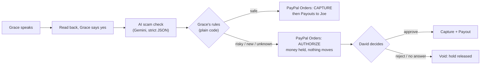

# Kin-bill

**Your family has your back before money moves.**

Kin-bill is a voice-first PayPal payment assistant for older and low-vision adults.
Grace says *"Pay my plumber Joe 80 dollars"*. An AI scam check and the rules she set with her son David decide:
safe payments go straight through PayPal; risky ones are only **held** (nothing moves) until David approves.
If David rejects, or nobody answers in time, the hold is cancelled and no money moves.

Built for the PayPal **Build What's Next with PayPal and AI** hackathon. **PayPal sandbox only, no real money.**

## Try it now

**Live demo: https://kinbill.onrender.com** (free hosting: the first visit after a quiet spell takes about a minute to wake up)

| Screen | How |
| --- | --- |
| Grace (pays by voice) | **I want to pay someone**. Use Chrome or Edge for voice, or the example buttons / *Type instead* |
| David (the helper) | **I'm the helper**, PIN **`2468`** |

A 2-minute tour:

1. **Safe payment:** on Grace's screen press **Pay Joe $80** and say or press **Yes**. It is paid through PayPal at once and Grace hears when Joe has the money.
2. **New person:** press **Pay Sam $40 (new person)**, Yes. It is **held**. Open David's screen in a second window: the payment is waiting with the reasons. **Approve**, and Grace hears that David approved it.
3. **Scam call:** press **"PayPal" scam call**. The AI flags impersonation and urgency; it is held, and David can **Reject**: the hold is cancelled, nothing moves.
4. **Coached victim:** on Grace's screen open **My safety rules** and try to raise her limit to $500. It is refused, and David's screen shows a warning that someone may be pressuring her.
5. Do nothing with a held payment: after 10 minutes online, the **safety timer** cancels it.
6. Switch **Screen: Light / Dark / Auto**, text size **A++** and voice **Slower**: built for low vision.

## How it works



- **The AI never moves money.** It returns a risk score and reasons in a strict JSON schema; plain-code rules decide.
  Gift cards, crypto, secrecy, impersonation and "someone told you what to say" always go to David. A keyword safety floor
  means the AI can only *raise* the risk, never lower it, and Grace's words are treated as untrusted input.
- **Grace links PayPal once** (vault). After that she never sees a PayPal screen; she just speaks.
- **Every step is logged** (who did what, when) and shown to David in AG Grid tables, live via Server-Sent Events.

### PayPal APIs used (sandbox)

OAuth 2.0 client credentials · **Orders v2** (CAPTURE and AUTHORIZE, vaulted PayPal wallet, `PayPal-Request-Id` idempotency) ·
**Payments v2** (capture and void authorizations) · **Payouts v1** · **Vault** (save PayPal during a $1 check that is released) ·
**Webhooks** (payout items, authorization voided, capture completed), every event verified with `verify-webhook-signature`.

### Built with

Node.js 24 + Express, built-in SQLite (`node:sqlite`), plain HTML/CSS/JS (no build step), Web Speech API (voice in and out),
Google Gemini (AI scam check; Claude optional), **AG Grid** (David's tables), **Render** (hosting, `render.yaml` Blueprint),
Atkinson Hyperlegible fonts (Braille Institute). 111 automated tests (`npm test`), including accessibility and contrast checks;
axe-core finds 0 issues on every page in light and dark.

## Run it on your own computer

Requirements: Node.js 22.9+ (24 recommended), a free PayPal Developer account with a sandbox app,
a sandbox **personal** account (Grace) and a second sandbox **business** account (Joe), and a free Gemini API key
(optional: without one, the built-in keyword checker is used).

```bash
git clone <this repo> && cd kinbill
npm install
cp .env.example .env      # Windows PowerShell: Copy-Item .env.example .env
# fill in .env: PAYPAL_CLIENT_ID, PAYPAL_CLIENT_SECRET, PAYEE_JOE_EMAIL, GEMINI_API_KEY
npm run check:paypal      # should print SUCCESS
npm run dev               # open http://localhost:3000
npm test                  # 111 tests, no network needed
```

On Grace's screen press **Connect PayPal** once and log in as the sandbox personal account. Tip: set
`HOLD_TIMEOUT_SECONDS=120` in `.env` to see the safety timer after 2 minutes.

## Build notes

| Feature | State |
| --- | --- |
| 1. Server skeleton, health check, PayPal token helper | Done |
| 2. Sandbox spike: capture, hold then void, hold then capture then payout | Done (passed in sandbox) |
| 3. Link PayPal once (vault), pay with no browser | Done (passed in sandbox) |
| 4. Grace's rules + database (settings, people paid before) | Done: `npm run try:rules` |
| 5. AI scam checker (Gemini or Claude, keyword safety floor) | Done: `npm run try:ai` |
| 6. Grace's voice screen | Done |
| 7. David's helper screen, live updates, AG Grid history | Done |
| 8. Safety timer, activity log, verified PayPal webhooks | Done |
| 9. Accessibility, Grace's safety rules, "Family Check" design, light / dark / auto | Done |
| 10. Online on Render | Done: https://kinbill.onrender.com |

## Feature 2: sandbox spike

```bash
npm run spike
```

For each test, open the printed link, log in as the sandbox **buyer** (Grace), approve,
then press Enter in the terminal. Expected: three PASS lines, and Joe's sandbox account
shows $80 and $150 received, but not the voided $600.

## Feature 3: link PayPal once

```bash
npm run spike:vault          # V1 needs Grace's approval in the browser once
npm run spike:vault -- V2    # rerun V2 and V3 with the saved link, no browser
```

## Feature 6: Grace's screen

```bash
npm run dev
```

Open **http://localhost:3000/grace.html** in Chrome or Edge (best for voice).

- Press **Tap and speak** and say *"Pay my plumber Joe 80 dollars"*, or use **Type instead** / the example buttons.
- Kin-bill reads it back; answer **yes** or **no** (voice or the big buttons).
- Safe payments to known contacts are charged to Kin-bill and paid out to the contact.
  Risky payments, new people and anyone not in Grace's contacts are **held** for David.
- Demo contacts: *Joe the plumber* (paid before) and *Sam the gardener* (new). Both use `PAYEE_JOE_EMAIL`.
- If PayPal isn't connected yet, press **Connect PayPal** (one time, $1 check released straight away).
  A link saved by `npm run spike:vault` is reused automatically.

## Feature 7: David's helper screen

Open **http://localhost:3000/david.html** and enter the `HELPER_PIN` from `.env` (default in `.env.example`: `2468`).

- **Waiting for you**: every held payment with the amount, what Grace said, the scam-risk score, the AI's explanation and the reasons.
- **Approve and pay**: Kin-bill captures the held money and pays it out to the contact (PayPal Payouts).
  If the person is not in Grace's contacts, David must enter their PayPal email; they are added to her contacts.
- **Reject**: the hold is voided; no money moves.
- Updates live (Server-Sent Events). Grace's screen tells her David's decision if her "Paused" box is still open.
- **All payments**: history table built with **AG Grid** (sponsor), served from `node_modules`, no CDN.

## Feature 8: safety timer, activity log, webhooks

- **Safety timer**: a held payment nobody decides on is voided after `HOLD_TIMEOUT_SECONDS`
  (48 h by default; set `120` for a 2-minute demo). Checked every `SWEEP_INTERVAL_SECONDS`.
  Grace hears that it was cancelled and that no money was sent.
- **Activity log**: every step (Grace asked, AI checked, rules, held, David approved, PayPal delivered,
  timer cancelled, ...) is recorded in `audit_log` and shown on David's screen (AG Grid).
- **Restarts are safe**: payouts still on their way are checked again when the server starts.
- **PayPal webhooks** at `POST /api/paypal/webhook`: every event's signature is verified with PayPal
  (`/v1/notifications/verify-webhook-signature`) before use; repeats are ignored. Needs a public URL
  and `PAYPAL_WEBHOOK_ID`, so it is switched on after deploying (feature 10).

## Feature 9: accessibility

Kin-bill is built for people with low vision, so accessibility is the product, not an extra.

- **Keyboard only**: every control works with Tab / Enter / Space. A **Skip to main content** link comes first.
  On "Is this right?" press **Y** for yes, **N** or **Esc** for no, **R** to hear it again (ignored while typing).
- **Screen readers**: everything Kin-bill says is also announced (live regions); focus moves to each new step;
  every button and field has a name; David's held cards are named "$40.00 to ..." and his buttons say who they pay.
- **Seeing**: 24 px base text, big targets (88 px buttons), thick yellow focus ring, AAA contrast (7:1+) for main text,
  works in Windows High Contrast mode, no zoom blocking, no motion.
- **Grace's comfort settings** (remembered on her device): text size **A / A+ / A++** and voice speed **Normal / Slower**,
  plus a **Say it again** button.
- **David's tables (AG Grid)**: rows and columns kept in reading order for screen readers, taller rows.
- Checked with **axe-core** in Chromium (0 violations on all pages, WCAG 2.2 AA rules) and by `test/a11y.test.js`
  (labels, button names, skip link, contrast ratios).

## Grace's safety rules

- **Grace's screen > My safety rules**: her rules in plain words, **Read my rules aloud**, and **Make my rules safer**
  (lower the limit, a more careful scam check, ask David about new people).
- **Only David can loosen rules** (raise the limit, relax the scam check), on his PIN screen.
  If Grace tries, nothing changes, she hears why, and David sees a warning: someone may be pressuring her.
  Scammers often tell people to "switch off" protections; this makes that impossible from Grace's side.
- Always on, whatever the settings: gift cards, crypto, secrecy, coaching, and people not in her contacts wait for David.
- API: `GET /api/settings`, `POST /api/settings` (stricter only), `POST /api/helper/settings` (PIN). Every change is in the activity log.

## Visual design: "Family Check"

- **PayPal-aligned colours**: one consistent PayPal blue (#0070BA) for every button, the talk button, selected
  options, table headers and links, with PayPal's deep navy as the text colour and pill-shaped buttons.
  Green, amber and red are kept only for meaning (sent, waiting, stopped).
  Kin-bill keeps its own name and logo and says it is not made or endorsed by PayPal.
- **Signature pieces**: a round talk button that pulses only while listening; the confirm step laid out like a cheque
  (Pay to / Amount / You said); a status pill on every result (Sent, Waiting for David, Not sent), never colour alone;
  David's decisions are signed ("Checked by David").
- **Themes**: Auto (follows the device), Light, Dark: the **Screen** buttons on every page, remembered per device.
  David's AG Grid tables switch too (Quartz theme with light and dark params).
- **Type**: Atkinson Hyperlegible Next and Mono (Braille Institute, designed for low vision), served from our own server.
- Contrast is tested for both themes in `test/a11y.test.js`; axe-core finds 0 issues on every page in light and dark.

## Feature 10: online on Render (how to deploy your own)

`render.yaml` describes the whole service (free plan, Node 24, health check `/api/health`).

1. Push the repo to GitHub.
2. On [render.com](https://render.com): **New > Blueprint**, pick this repo. Render reads `render.yaml`.
3. Fill in the secrets it asks for: `PAYPAL_CLIENT_ID`, `PAYPAL_CLIENT_SECRET`, `PAYEE_JOE_EMAIL`,
   `GEMINI_API_KEY`, and `KINBILL_VAULT_ID` (the `vaultId` from your local `.kinbill-vault.json`).
4. After the first deploy, add a PayPal webhook pointing to `https://YOUR-APP.onrender.com/api/paypal/webhook`
   and put its ID in `PAYPAL_WEBHOOK_ID`.

Online behaviour:
- Render's free plan sleeps after 15 minutes without visitors (the first visit then takes about a minute)
  and starts with an empty database. Kin-bill restores Grace's PayPal link from `KINBILL_VAULT_ID`,
  re-adds the demo contacts and, with `KINBILL_DEMO=1`, three example payments, so it is always ready to try.
- Held payments are auto-cancelled after 10 minutes online (`HOLD_TIMEOUT_SECONDS=600`).
- Basic protection for a public app: at most 20 payment requests per minute per visitor (protects the AI key),
  and 10 wrong helper PINs lock that visitor out for 15 minutes.

## Project layout

```
server/
  index.js          starts the server
  app.js            routes (health checks so far)
  config.js         reads .env; refuses to run against live PayPal
  paypal/client.js  OAuth token + request helper
  paypal/orders.js  create / capture / authorize / void / payouts
  rules/engine.js   Grace's rules: pay now or ask David
  db.js             SQLite (built into Node): settings, contacts, PayPal link, payments
  ai/               AI scam checker + keyword safety floor
  payments/service.js  the payment flow: read back, pay now or hold for David
public/             landing page, Grace's screen (grace.*), David's screen (david.*), styles.css, theme.js (light/dark/auto)
scripts/            check-paypal.js, spike-paypal.js
test/               node:test unit tests with a fake fetch
```

## License

MIT, see [LICENSE](LICENSE).
